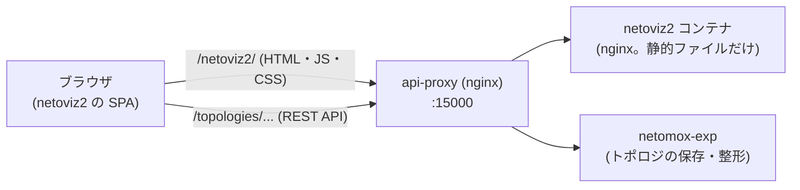
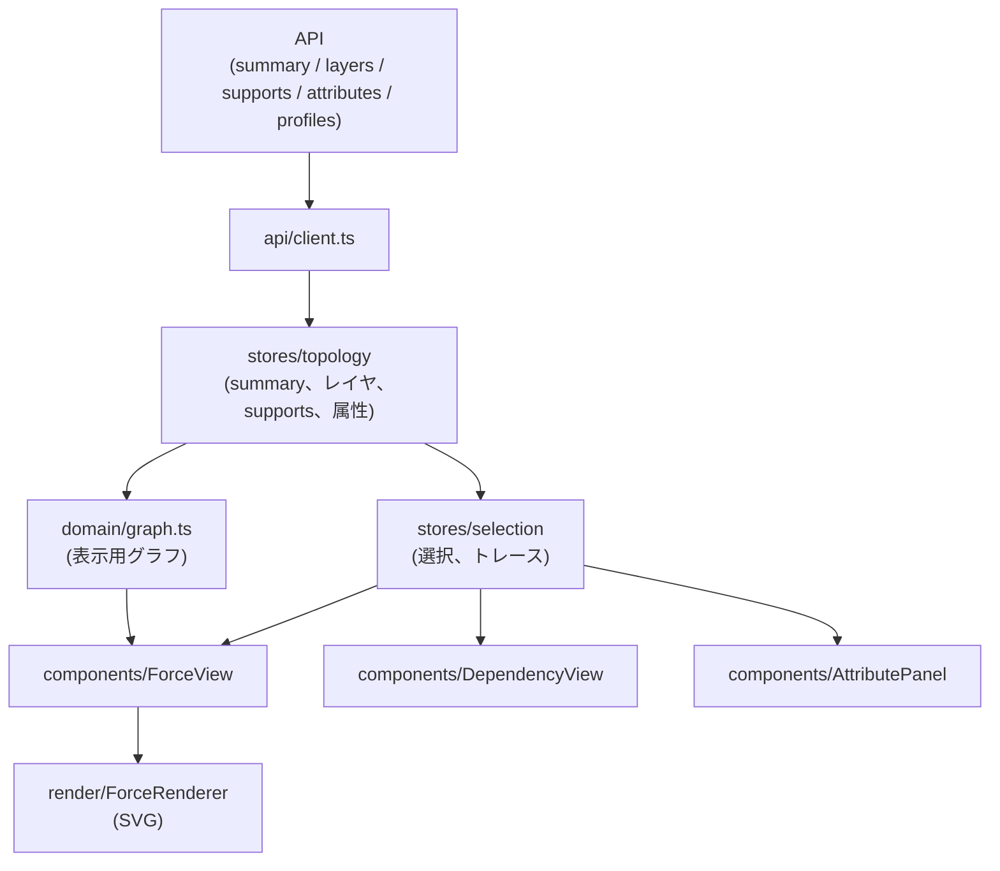
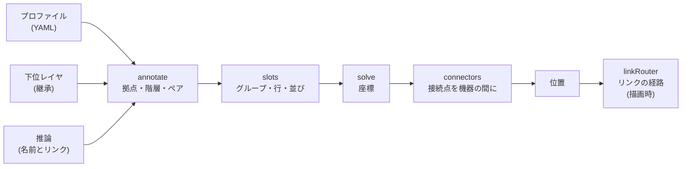

# netoviz2 の構成・アーキテクチャ

netoviz2 の構成を説明します。コードを読む・直す人向けです。使い方は [README](../README.md)、開発手順は [development.md](development.md)、
レイアウトの設計は [design/layout.md](design/layout.md) と [design/schematic_layout.md](design/schematic_layout.md) を参照してください。

## 1. 位置づけ

netoviz2 は、ool-mddo の**マルチレイヤのネットワークトポロジ用ビューワー**です。Vite + Vue 3 + TypeScript の静的な SPA (フロントエンドのみ) で、次の方針で作られています。

- **データの加工は持たない。** トポロジの読み込み・整形は、バックエンド (netomox-exp) の `/topologies/:network/:snapshot/netoviz2/*` API が行い、netoviz2 は REST API で取得して描画・操作に専念する。ローカルのファイルやサーバ機能は持たない。
- **ユースケースに依存しない。** ユースケース名・ネットワーク名・レイヤの種類 (`kind`)・属性スキーマで処理を分岐しない。未知のものは汎用の表示にする。
- **オブジェクトの ID は不透明な文字列。** 分解しない (例外は、先頭のセグメントがレイヤの ID であることを使う `layerOfId` だけ)。

データ形式と API 仕様 (netomox-exp と netoviz2 の共通の仕様) は、playground の
[`docs/netoviz2_data_format.md`](https://github.com/ool-mddo/playground/blob/main/docs/netoviz2_data_format.md) にあります。

## 2. システム内の位置



- ブラウザは、同じオリジン (api-proxy) から、静的ファイル (`/netoviz2/`) と API (`/topologies/...`) の両方を取得する。
- netoviz2 のコンテナは、ビルドした静的ファイルを nginx で配信するだけで、API は持たない。
- 開発サーバ (`npm run dev`) では、`/topologies` を api-proxy (`NETOVIZ2_API_URL`) へ転送する。

## 3. ソースの構成

```
src/
  main.ts            起動 (Pinia、ルーター、テーマ)
  App.vue            ヘッダー (パンくず、テーマ切替) と画面 (RouterView)
  router.ts          画面の URL
  api/               netomox-exp の netoviz2 API の型 (types.ts) とクライアント (client.ts)
  stores/            Pinia のストア (トポロジ、選択、表示状態、テーマ、一覧)
  domain/            画面や描画に依存しない純粋なロジック
  composables/       Vue の部品化したロジック (選択、定期更新)
  components/        画面の部品
  views/             画面 (一覧、スナップショットの一覧、トポロジ)
  render/            描画 (ForceRenderer) とレイアウト、リンクの経路
    layout/            レイアウトエンジン (stress、schematic) と共通の部品
      schematic/         構成図向けのレイアウト
  styles/            テーマ (CSS の変数)
  test/              テスト用のデータ (フィクスチャ)
```

各ディレクトリの役割:

| ディレクトリ   | 役割                                                                                                       | 依存してよいもの                |
| -------------- | ---------------------------------------------------------------------------------------------------------- | ------------------------------- |
| `api/`         | API の型とクライアント (ETag 対応。属性の取得は 200 件ごとに分割)                                          | なし                            |
| `domain/`      | support の索引・トレース・チェック、リンクの束ね、表示用グラフの構築、diff、ポートの角度、レイアウトの評価 | `api/` の型                     |
| `stores/`      | 共有する状態 (トポロジのデータ、選択、展開状態、テーマ)                                                    | `api/`、`domain/`               |
| `composables/` | 選択の処理 (`useSelect`)、定期更新 (`usePolling`)                                                          | `stores/`、`domain/`            |
| `components/`  | 画面の部品                                                                                                 | `stores/`、`domain/`、`render/` |
| `views/`       | 画面 (URL と対応)                                                                                          | 上のすべて                      |
| `render/`      | SVG の描画、レイアウト、リンクの経路 (Vue のリアクティブ機構を通さない)                                    | `domain/` の型                  |

選択・support のトレース・属性の表示は、描画方式 (Viewer) に依存しない共通の部品 (`domain/`、`stores/`) で実装し、描画はその上に載せます。

## 4. 画面と URL

| URL                            | 画面           | 内容                       |
| ------------------------------ | -------------- | -------------------------- |
| `/netoviz2/`                   | `HomeView`     | network の一覧             |
| `/netoviz2/:network`           | `NetworkView`  | network の snapshot の一覧 |
| `/netoviz2/:network/:snapshot` | `TopologyView` | トポロジの表示             |

`TopologyView` の構成:

```
TopologyView
├─ SummaryBar        トポロジの概要 (networks の flags、警告、diff の有無)
├─ LayerList         レイヤの表示切替 (左のカラム。タブで細い帯に折りたためる)
├─ ViewToolbar       Term-points、Trace、Dependency view の切替
├─ ForceView         トポロジ表示 (ForceRenderer を使う) + エンジンとレイヤの並べ方の切替。図の下に、統計と schematic のパネル
├─ DependencyView    選択したオブジェクトの依存ツリー (副画面。?dependency=1)。図の下に、注意文と問題の一覧
└─ AttributePanel    選択したオブジェクトの属性・diff・support
```

### 画面の配置

`TopologyView` は、左のレイヤ一覧、図 (ForceView、DependencyView)、AttributePanel を 1 つのグリッドに並べます。

- **高さを揃える:** 図の部分 (ツールバーと svg) と AttributePanel は、同じ固定の高さ (`.layout` の `--viewer-height`、72vh) です。svg はその残りを使うので、メッセージが増減しても大きさが変わりません。
- **情報は図の下に足す:** 統計、schematic のパネル、注意文、問題の一覧は、各 View の `.info` に表示します。高さは固定せず、内容なりに伸ばします (ページが下に伸びる。図を小さくしない)。
- **レイヤ一覧の折りたたみ:** 「Layers」タブで、左のカラムを細い帯 (`--side-width`) にできる。選択はブラウザの `localStorage` (`netoviz2.sideCollapsed`) に保存する。幅が変わったら、各 View に `fitSignal` で知らせて、図を新しい大きさに合わせ直す。
- **favicon:** `public/` に置く (`favicon.svg`、`favicon.ico`、`apple-touch-icon.png`)。ool-mddo の組織のアイコンを、小さくても見分けられるように単純化したもの。`index.html` から参照する (ビルドで `/netoviz2/` 配下のパスになる)。

### URL に持つ状態

表示の状態は URL のクエリで指定でき、リンクで共有できます。

| クエリ       | 内容                                                                                                                      |
| ------------ | ------------------------------------------------------------------------------------------------------------------------- |
| `layers`     | 表示するレイヤ (ID をカンマ区切り。省略すると、ノードの合計が 300 以下ならすべてのレイヤ、超えるときは最上位のレイヤだけ) |
| `sel`        | 選択中のオブジェクトの ID                                                                                                 |
| `layout`     | レイアウトエンジン: `stress` (既定) / `force` / `schematic`                                                               |
| `profile`    | schematic のプロファイルの名前                                                                                            |
| `dependency` | `1` で依存関係の副画面を表示                                                                                              |

URL を直接書き換えた場合も、選択・レイヤ・エンジンは URL から復元されます (`TopologyView` が `route.query` を読む)。

## 5. データの流れ



1. `TopologyView` が、URL の network / snapshot で `topology` ストアを開く (`summary` を取得)。
2. 表示するレイヤ (`layers`) の構造 (`layers/:layer`) を、必要なときに取得する。supports と属性も、必要になったときに取得する。
3. `ForceView` が、表示するレイヤのデータから表示用グラフ (`buildDisplayGraph`) を作り、`ForceRenderer` に渡す。
4. オブジェクトを選ぶと (`useSelect`)、`selection` ストアが support のトレースを計算し、`ForceRenderer` (強調)、`DependencyView` (依存ツリー)、`AttributePanel` (属性) が反映する。
5. schematic レイアウトのとき、network のプロファイル (`profiles`) を取得して、`target` に合うものを選ぶ (`?profile=` ならそのファイルだけ)。
6. 5 秒ごとに `summary` の ETag を確認し (`usePolling`)、更新があれば再読込する。

### 状態管理 (Pinia)

| ストア      | 持つもの                                                                                                                |
| ----------- | ----------------------------------------------------------------------------------------------------------------------- |
| `topology`  | 開いているトポロジ: `summary`、読み込んだレイヤの構造、`SupportIndex`、属性、更新の世代。古い snapshot への応答を捨てる |
| `selection` | 選択中の ID、トレースの方向 (`both` / `upper` / `lower` / `off`)、トレースの結果                                        |
| `view`      | term-point を表示するノード (既定は規模で自動。ダブルクリックで個別に切替)                                              |
| `theme`     | ライト / ダーク / 自動 (ブラウザに保存)                                                                                 |
| `index`     | network / snapshot の一覧                                                                                               |

大きなデータ (レイヤの構造、属性) は `shallowRef` で持ち、Vue の深いリアクティブ化を避けています。

## 6. 描画 (ForceRenderer)

`render/forceRenderer.ts` が、トポロジ表示の本体です (d3-force + d3-selection + d3-zoom + d3-drag で SVG を描く)。位置が毎ティック変わるため、
**Vue のリアクティブ機構を通さず、DOM を直接更新**します。

- **要素:** ノードは円、term-point (展開したとき) はノードの円周上のポート、リンクは線 (束ねた複数のリンクは 1 本)。ノードの半径は、ポートの数で決まる。
- **ポート:** 優先順位は、ユーザーがドラッグしたポート > 直線のリンクのポート (相手ノードの中心の方向。同じノード間の複数のリンクは平行に並べる) > それ以外 (迂回するリンクのポート、リンクの無いポート。他を動かさず空き位置に置く)。最小の間隔は弧の長さ 14px (`domain/ports.ts`、[design/layout.md](design/layout.md))。
- **操作:** ズーム・移動 (d3-zoom)、ノードのドラッグ (schematic は、シミュレーションを使わず、20px のグリッドに丸めて動かす。Shift = 行 (縦方向だけ)、Ctrl/⌘ = 列 (横方向だけ)。[design/schematic_layout.md](design/schematic_layout.md) の「手で動かす」)、ポートのドラッグ (円周上)、クリック (選択)、ダブルクリック (term-point の展開)、ホバー (相手のポートや support の先を強調)。
- **レイアウトの実行:** 表示するレイヤが全部読み込まれてから、レイヤごとに配置して、並べる (`layout/pack.ts`)。並べ方は、既定が縦 1 列 (中央揃え)、`?layerlayout=grid` (または画面の Layers セレクト) で格子 (`ceil(sqrt(レイヤ数))` 列)。force エンジンは、レイヤ中心 (`layerCenter`) へ引く力で同じ並びにする。同じグラフは配置し直さない。
- **強調:** 選択・トレース・ホバーを、CSS のクラス (`selected` `traced` `peer` `dim` など) で表す。

`ForceView` が、ストアの状態 (グラフ、強調、エンジン、プロファイル) を `ForceRenderer` に渡します。`ForceRenderer` はストアを直接知りません。

## 7. レイアウトエンジン

| エンジン        | 内容                                                  | 実装                       |
| --------------- | ----------------------------------------------------- | -------------------------- |
| `stress` (既定) | ストレス最小化 (自前の実装)。交差が少ない、コンパクト | `render/layout/stress.ts`  |
| `force`         | d3-force のシミュレーション                           | `render/forceRenderer.ts`  |
| `schematic`     | 向き・並びに意味を持たせた構成図 (プロファイルに従う) | `render/layout/schematic/` |

`stress` と `schematic` は、レイヤごとにノードの位置を返す非同期の関数として、`ForceRenderer` に差し替えられます。
各エンジンの設計と、ELK を採用しなかった理由は [design/layout.md](design/layout.md) を参照してください。
dependency 表示 (レイヤの帯) は、レイアウトエンジンとは別の仕組みです (`render/layout/bands.ts`)。

## 8. schematic レイアウトの構成

schematic は、1 レイヤずつ、次の流れで位置を決めます (詳細は [design/schematic_layout.md](design/schematic_layout.md))。



| ファイル                                     | 役割                                                                                         |
| -------------------------------------------- | -------------------------------------------------------------------------------------------- |
| `profile.ts`、`profileSource.ts`、`types.ts` | プロファイルの検証 (JSON)、取得したファイルからの選択 (`target`)、型                         |
| `annotate.ts`                                | ノード名の分解と規則の適用で、拠点・階層・順序・ペアを付ける                                 |
| `nameShape.ts`、`infer.ts`                   | プロファイルが無いときの推論 (名前の形、拠点・役割・階層・ペア) と、下書きの YAML            |
| `inherit.ts`、`domain/schematicBases.ts`     | support をたどって、下位レイヤの配置を引き継ぐ                                               |
| `slots.ts`                                   | 拠点を左右、階層を行、行内を重心法で並べる (離散的な配置)                                    |
| `solve.ts`                                   | 座標を決める (行ごとの最小間隔と、行間のリンクを直線に近づける反復)                          |
| `connectors.ts`                              | 機器をつなぐ接続点 (L3 セグメントなど) を、機器の間に置く                                    |
| `move.ts`                                    | 手で動かすときの、動かすノードの決定 (行・列・他レイヤへの連動)、グリッド、接続点の置き直し  |
| `index.ts`                                   | 上の手順をつなぐ。プロファイル → 継承 → 推論 → stress の順に試す。配置の由来と例外を報告する |
| `render/linkRouter.ts`、`render/path.ts`     | リンクの経路 (水平・垂直の折れ線) と、角を丸めた SVG のパス                                  |

`ForceView` は、schematic のために、プロファイルの読み込みと、下位レイヤの読み込みを待ってから `ForceRenderer` に配置を依頼します。
リンクの経路は、配置ではなく、**描画のたびに**現在のノードとポートの位置から `ForceRenderer` が求めます (ノードを動かすと追従する)。

## 9. ビルド・配信・CI

- **ビルド:** Vite。`base` は `/netoviz2/` (api-proxy の配下で配信するため)。`npm run build` が `vue-tsc` の型検査の後に `dist/` を作る。
- **コンテナ:** `Dockerfile` は 2 段。node でビルドし、nginx で `/netoviz2/` 配下に静的ファイルを配信する (ランタイムの Node は含まない)。`nginx.conf` は、ハッシュ付きのファイルを長期キャッシュし、それ以外の URL を `index.html` に返す (SPA)。
- **CI (GitHub Actions):** push で lint・型検査・テストを実行し、成功したらイメージ `ghcr.io/ool-mddo/netoviz2:<ブランチ名>` を作る。タグはブランチ名なので、**ブランチ名にスラッシュを入れない**。

## 10. テスト

Vitest + happy-dom。テストは、対象のファイルと同じディレクトリの `*.test.ts` に置きます。

| 対象                               | 内容                                                                          |
| ---------------------------------- | ----------------------------------------------------------------------------- |
| `domain/`                          | 純粋な関数 (トレース、束ね、グラフ構築、ポートの角度など)                     |
| `stores/`、`views/`、`components/` | API のクライアントをモックして、画面の挙動を確認する (`src/test/fixtures.ts`) |
| `render/forceRenderer.test.ts`     | 描画の DOM、エンジンの切替、経路の追従 (ノードの位置を直接変えて `draw`)      |
| `render/layout/`                   | stress の品質 (交差・重なり)、schematic の各段                                |
| `render/linkRouter.test.ts`        | 経路の単体テストと、乱数配置の性質テスト                                      |

schematic のテストは、実データから抜き出したフィクスチャ (`src/test/mddoFwLayer1.ts`、`mddoFwStack.ts`、`sampleLayers.ts`) を使います
(ノード名・リンク・support だけを持つ)。

## 11. 依存関係とライセンス

実行時の依存は、vue、vue-router、pinia、d3-drag / d3-force / d3-selection / d3-zoom、yaml (推論した下書きの YAML の書き出しだけ。読まない) です。
依存は、寛容なライセンス (MIT / ISC / BSD 系) のものにします。ELK (elkjs, EPL-2.0) は、検証して採用しませんでした ([design/layout.md](design/layout.md))。
